# QueueLess — Real-Time Queue and Service Management System

QueueLess is a web-based queue management system that digitizes token generation, queue monitoring, and service-counter operations. It helps customers track their place in a queue while enabling staff to manage token flow and administrators to monitor service activity.

## Overview

Traditional queues can be difficult to monitor and manage. QueueLess provides a centralized interface for generating tokens, viewing queue status, managing service counters, and reviewing queue activity.

## Key Features

- **Customer token generation and lookup:** Generate a token for a service and look up its status.
- **Live queue display:** View queue information with automatic and manual refresh support.
- **Staff queue operations:** Call the next token, recall a token, start service, complete service, skip a token, and return a token to the waiting queue.
- **Token history:** Review a token’s status and event timeline.
- **Analytics:** View queue and service activity through an analytics dashboard.
- **Role-based access:** Separate customer, staff, and administrator workflows.
- **CSV export:** Export available analytics data for further review.

## User Roles

| Role | Main purpose |
|---|---|
| Customer | Generate and look up tokens |
| Staff | Manage tokens and service-counter operations |
| Administrator | Access administrative and analytics features |

## Technology Stack

| Layer | Technologies |
|---|---|
| Frontend | React 18, Vite, React Router, Tailwind CSS, Recharts, Lucide React |
| Backend | Node.js, Express.js |
| Database | SQLite with `better-sqlite3` |
| Authentication | JWT, `bcryptjs` |
| Testing | Jest, Supertest, Vitest |

## Application Screenshots

| Screen | Preview |
|---|---|
| Home page | 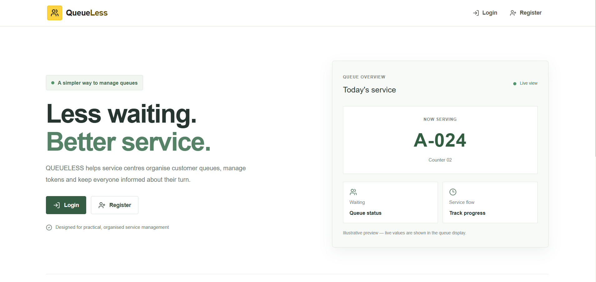 |
| Customer page | 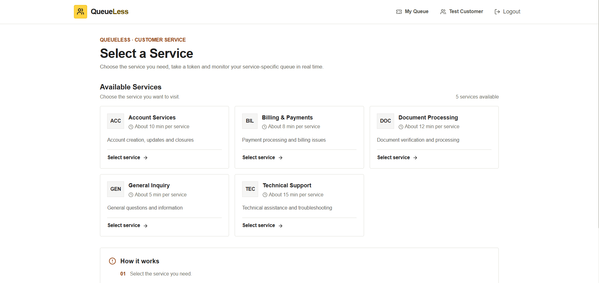 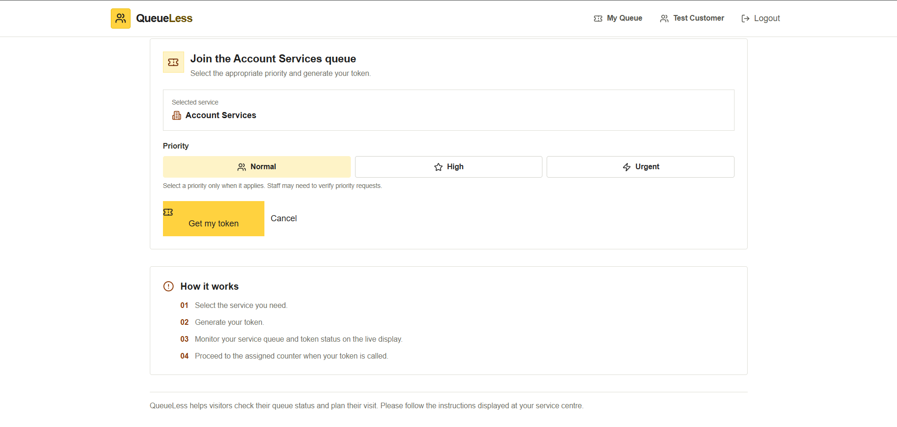 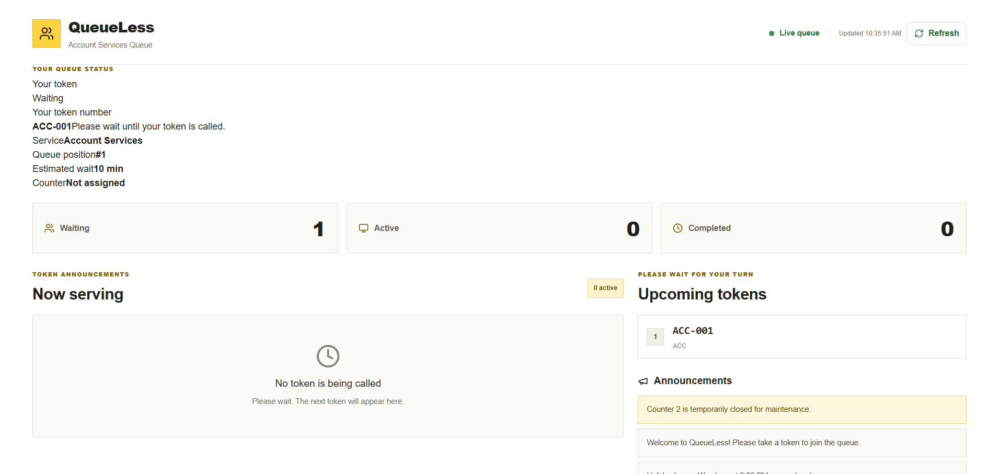 |
| Staff page | 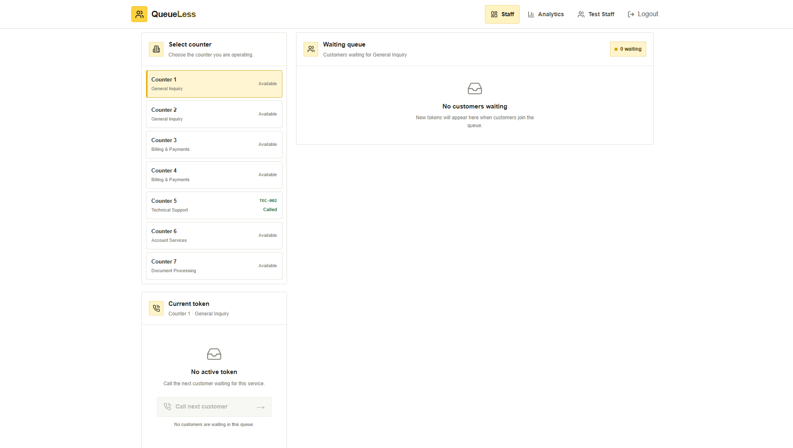 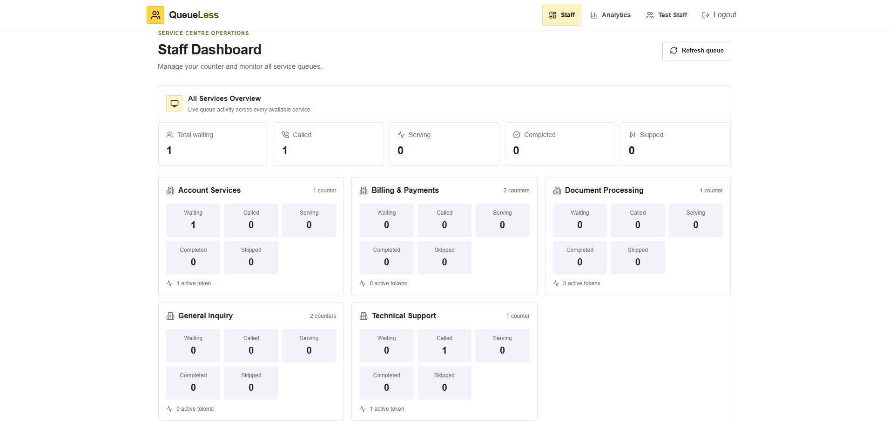 |
| Display page | 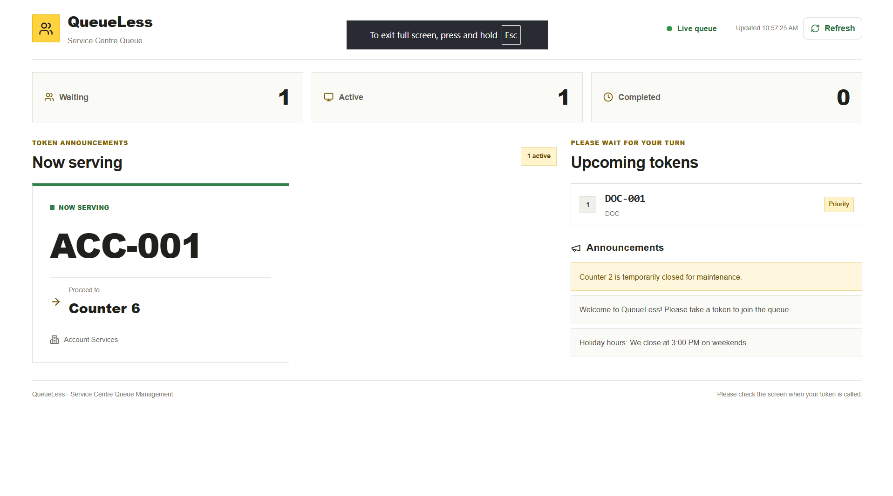 |
| Token history | 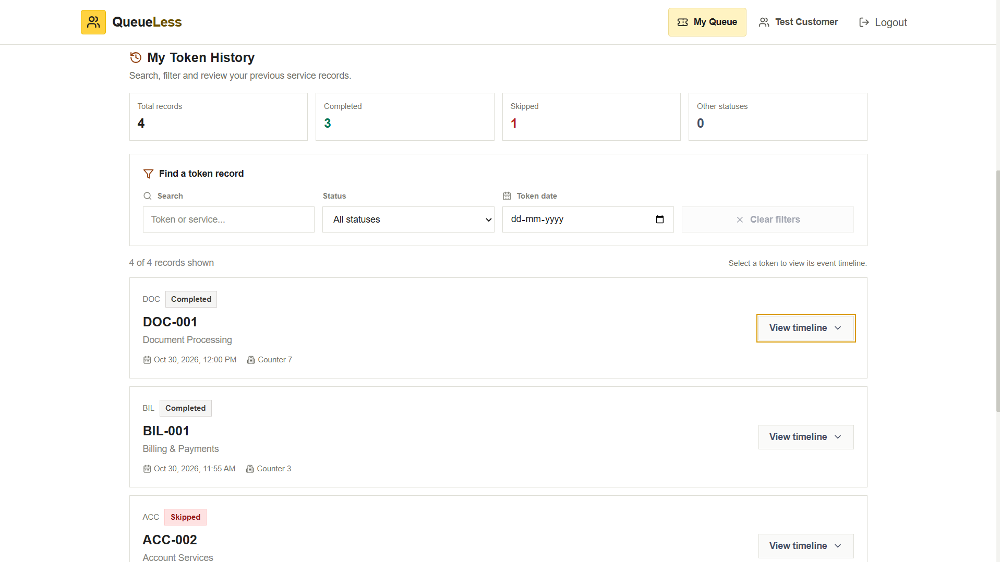 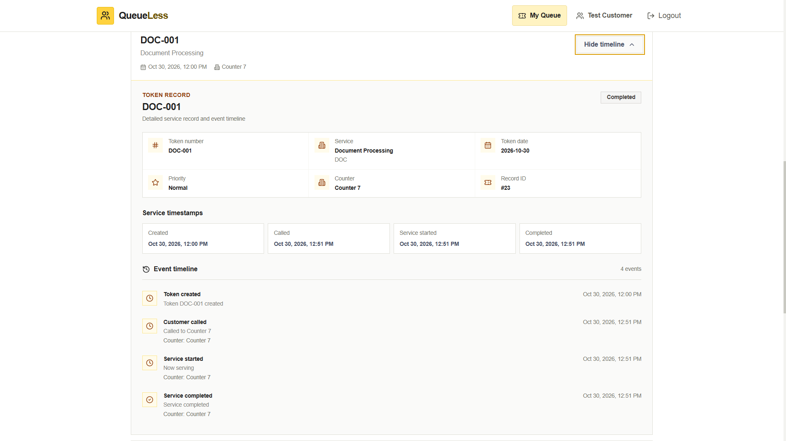 |
| Analytics | 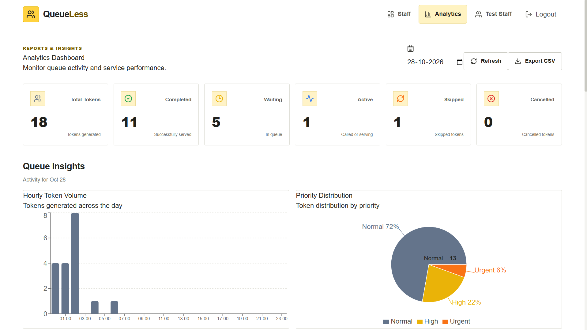 |
| Admin page | 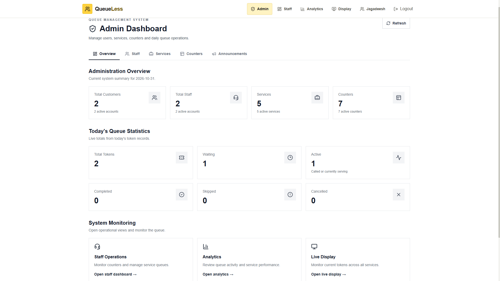 |

## Getting Started

### Prerequisites

- Node.js and npm
- Git

### 1. Clone the repository

```bash
git clone https://github.com/Jagadeesh-0609/QueueLess.git
cd QueueLess
```

### 2. Install dependencies

Install the backend dependencies:

```bash
cd server
npm install
```

Install the frontend dependencies:

```bash
cd ../client
npm install
```

### 3. Configure environment variables

Create a local environment file at `server/.env` using `server/.env.example` as a reference.

Set the required values, including a strong, private `JWT_SECRET`. Keep your actual `.env` file local and do not commit it to GitHub.

### 4. Start the backend

From the project root, open a terminal and run:

```bash
cd server
npm run dev
```

### 5. Start the frontend

Open a second terminal in the project root and run:

```bash
cd client
npm run dev
```

Open the local URL shown in the Vite terminal output.

## Testing

Run the backend test suite from the `server` directory:

```bash
npm test
```

Run the frontend production build from the `client` directory:

```bash
npm run build
```

## Project Structure

```text
QueueLess/
├── .gitignore
├── README.md
├── client/
│   ├── public/
│   │   └── vite.svg
│   ├── src/
│   │   ├── components/
│   │   │   ├── Badges.jsx
│   │   │   ├── ErrorMessage.jsx
│   │   │   ├── LoadingSpinner.jsx
│   │   │   ├── Navbar.jsx
│   │   │   ├── ProtectedRoute.jsx
│   │   │   └── TokenHistory.jsx
│   │   ├── context/
│   │   │   └── AuthContext.jsx
│   │   ├── pages/
│   │   │   ├── AdminPage.jsx
│   │   │   ├── AnalyticsPage.jsx
│   │   │   ├── CustomerPage.jsx
│   │   │   ├── DisplayPage.jsx
│   │   │   ├── HomePage.jsx
│   │   │   ├── LoginPage.jsx
│   │   │   ├── RegisterPage.jsx
│   │   │   ├── SelectServicePage.jsx
│   │   │   └── StaffPage.jsx
│   │   ├── services/
│   │   │   └── api.js
│   │   ├── App.jsx
│   │   ├── index.css
│   │   └── main.jsx
│   ├── index.html
│   ├── package.json
│   ├── package-lock.json
│   ├── postcss.config.js
│   ├── tailwind.config.js
│   └── vite.config.js
├── server/
│   ├── scripts/
│   │   └── createStaff.js
│   ├── src/
│   │   ├── config/
│   │   │   ├── createAdmin.js
│   │   │   ├── database.js
│   │   │   └── seed.js
│   │   ├── middleware/
│   │   │   ├── auth.js
│   │   │   ├── errorHandler.js
│   │   │   └── validation.js
│   │   ├── routes/
│   │   │   ├── admin.js
│   │   │   ├── analytics.js
│   │   │   ├── announcements.js
│   │   │   ├── auth.js
│   │   │   ├── counters.js
│   │   │   ├── services.js
│   │   │   └── tokens.js
│   │   ├── services/
│   │   │   ├── analyticsService.js
│   │   │   └── tokenService.js
│   │   └── index.js
│   ├── tests/
│   │   └── api.test.js
│   ├── .env.example
│   ├── .gitignore
│   ├── package.json
│   └── package-lock.json
└── docs/
    └── screenshots/
        ├── home.png
        ├── customer-1.png
        ├── customer-2.png
        ├── customer-3.png
        ├── staff.png
        ├── staff-overview.png
        ├── queue-display.png
        ├── token-history.png
        ├── token-history-timeline.png
        ├── analytics.png
        └── admin.png
```

## Current Project Status

QueueLess includes customer token workflows, staff queue operations, queue display, token history, analytics, and role-based access. The backend security review and regression tests have been completed, and the frontend production build has been verified.

## Future Enhancements

- **Production deployment:** Deploy the frontend and backend to a production hosting environment and configure production environment variables.
- **Automated deployment pipeline:** Add continuous integration for tests and build validation, followed by controlled deployment.
- **Real-time queue updates:** Evaluate WebSockets or server-sent events to reduce reliance on periodic polling.
- **Queue notifications:** Add optional customer notifications when a token is approaching or has been called.
- **Queue cancellation:** Add a controlled customer cancellation flow, with appropriate status handling and audit history.
- **Operational reporting:** Expand analytics with configurable date ranges, service-level comparisons, and downloadable reports.
- **Accessibility and usability:** Improve keyboard navigation, screen-reader support, and responsive layouts.
- **Production hardening:** Add operational monitoring, backups, rate limiting, and deployment-specific security configuration.

## Security Notes

- Do not commit `.env` files, private keys, database files, or production credentials.
- Use a strong, unique secret for `JWT_SECRET`.
- Configure production CORS, secrets, and database storage for the deployment environment.
- Use test or demo data in screenshots. Do not publish real customer or staff information.

## Authors

- **G. Jagadeeshwar Reddy**
- **Abdul Sameer Khan**
- **B. Yazdaan**

GitHub: [Jagadeesh-0609](https://github.com/Jagadeesh-0609)

## License

No license has been selected for this repository yet. Add a license only after deciding how you want others to use, modify, and distribute the project.